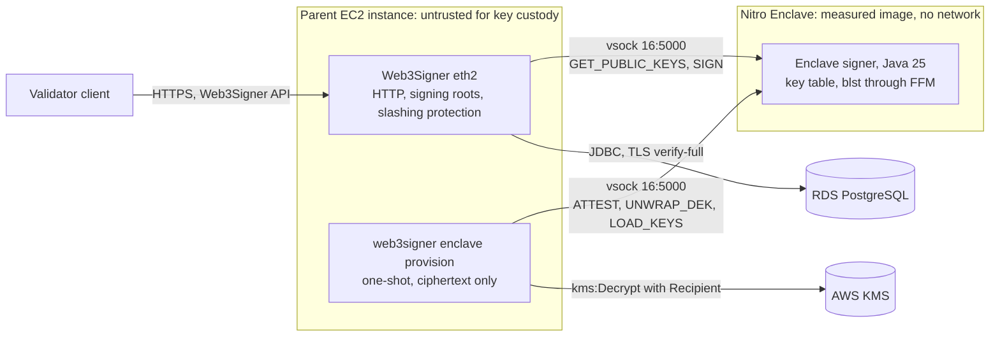

# Web3Signer with an AWS Nitro Enclave signer

This guide deploys Web3Signer so that your BLS validator keys exist in plaintext only inside an
[AWS Nitro Enclave](https://docs.aws.amazon.com/enclaves/latest/user/nitro-enclave.html). A small
signer runs in the enclave and holds the keys. Web3Signer runs next to it on the same EC2 instance,
serves your validator client as usual, keeps slashing protection in PostgreSQL, and asks the enclave
for each signature. AWS KMS releases the keys only to an enclave image you have measured and
approved.

> **Status: experimental.** The `--Xenclave-signer-*` options are hidden and can change without
> notice. The guide was followed end to end on 2026-11-18 in `us-east-1`, on an `m5.xlarge` with
> Amazon Linux 2023.12.20261109 (kernel 6.18.56), Nitro CLI 1.5.0, Docker 25.0.14, Amazon Corretto
> 25.0.5 and RDS for PostgreSQL 17.9, with 10,000 test keys on the Hoodi network.

## What it protects and what it does not

What you get:

| Guarantee | How |
|---|---|
| Nobody on the EC2 instance can read the keys, not even root | The instance only ever holds the keys encrypted. The enclave has no network and no call that returns key material. |
| Only the enclave image you approved can open the keys | KMS hands out the key that opens your keys only to an enclave that proves, with a document signed by AWS, that it runs the image you named in the KMS key policy. The answer is encrypted to a key that exists only inside that enclave. |
| An enclave started in debug mode gets nothing | Debug mode makes the enclave report a measurement of all zeros, which a production key policy does not accept. |

What you do not get:

- **Slashing protection still rests on Web3Signer.** Any process on the instance can ask the
  enclave to sign any data, slashable messages included. Only Web3Signer checks slashing protection.
  Protect the instance as you protect a Web3Signer host today.
- **A KMS key administrator can release the keys to another image.** Whoever may change the key
  policy can point it at a different image. Choose the key administrators with that in mind.
- **A debug enclave is for throwaway keys only.** Any debug enclave started by the instance role can
  open keys sealed under a debug key. Never seal real validator keys under it.
- **Every rebuild of the enclave image changes its measurement.** After a rebuild you update the KMS
  key policy before the new image can load keys. Images are not reproducible yet.

## How it works



Terms used in this guide:

- **Parent instance**: the EC2 instance that runs the enclave. Web3Signer runs on it directly, not in
  a container.
- **Enclave image (EIF)**: the file `nitro-cli` builds from a Docker image and starts as an enclave.
- **PCR0**: the measurement (a SHA-384 hash) of an enclave image. The same image always has the same
  PCR0; any change gives another.
- **Attestation document**: a document signed by the Nitro hypervisor that states the PCR0 of the
  running enclave and carries a public key generated inside it. KMS reads it.
- **Data key**: a random AES key that encrypts your BLS keys. KMS keeps it wrapped under a KMS key.
- **Bundle**: the file with your encrypted BLS keys and the wrapped data key. It holds no plaintext
  secret.

Where each secret exists:

| Item | Operator machine | Parent instance | Enclave |
|---|---|---|---|
| BLS secret keys | In memory, during sealing only | Encrypted, in the bundle | Plaintext, in memory |
| Data key | In memory, during sealing only | Wrapped by KMS, then encrypted to the enclave | Plaintext, while keys are loaded |
| AWS credentials | The operator's own | The instance role | None |

The four flows:

1. **Seal**, once, on the operator's machine: keystores, a new data key from KMS, the bundle file.
2. **Provision**, after every enclave start, on the parent: the enclave proves its image to KMS
   through the parent, receives the data key and loads the bundle.
3. **Load**, when Web3Signer starts or reloads: Web3Signer asks the enclave which public keys it holds.
4. **Sign**, for every request: Web3Signer computes the signing root, the enclave signs it, and
   Web3Signer checks slashing protection as today.

Three roles take part. One person can hold all three for a trial, but in production give each its own
identity, and never let the parent role act as operator or key administrator:

| Role | Does | Can | Cannot |
|---|---|---|---|
| KMS key administrator | Creates the KMS keys, writes their policies | Change which image may receive the keys | Use the key to create or open data keys (unless the policy says so) |
| Operator | Seals validator keys into a bundle | Create data keys | Open a bundle later |
| Administrator of the parent instance | Builds and runs the enclave and Web3Signer | Ask KMS to release the data key to an attested enclave | Obtain the data key or a BLS key |

## Before you start

Supported set-up:

- An x86_64 instance type that supports Nitro Enclaves
  ([list](https://docs.aws.amazon.com/enclaves/latest/user/nitro-enclave.html#nitro-enclave-reqs)),
  with enclaves enabled, running Amazon Linux 2023.
- At least 4 vCPUs: the parent keeps at least 2, and with hyper-threading the enclave takes whole
  cores (an even number of vCPUs).

Have ready:

- Your validator keystores (EIP-2335) and their passwords.
- A PostgreSQL database the parent can reach (version 17 was tested), or the right to create one on
  Amazon RDS.
- Three IAM identities for the roles above, with the permissions listed in step 3.

Sizing, as measured on an `m5.xlarge` (Intel Xeon Platinum 8175M) with 10,000 keys in the enclave:

- An enclave with 2 vCPUs is one physical core. One BLS signature took 452 µs.
- One signing request from the parent took 715 µs at the median (p99 about 1.1 ms): the vsock hop
  adds about 265 µs to the signature.
- With the default settings Web3Signer sends up to 8 requests per write. Under load the enclave then
  signed 2,150 to 2,160 signatures per second, close to what its core can compute. More connections
  added only tail latency.
- Debug and production mode signed at the same rate.
- Enclave memory comes in the steps of the allocator's reservation (1 GiB with hugepages). The signer
  left about 800 MB of 1024 MiB unused. The enclave image is about 80 MB.
- The enclave accepted connections about 2.3 s after `nitro-cli run-enclave` started. Provisioning
  10,000 keys took about 2 s; after `systemctl restart web3signer-enclave` the keys were back about
  8 s later.

## Names

The commands below use these variables. Set them in every shell you use and fill in the values in
`<angle brackets>`. The commands work in bash and zsh.

```bash
export AWS_REGION=<region>                       # region of the instance and of the KMS keys
ACCOUNT=<account id>
ENCLAVE_NAME=web3signer-enclave
ENCLAVE=vsock:16:5000                            # enclave CID 16, signer port 5000
EIF=/opt/web3signer-enclave/web3signer-enclave.eif
BUNDLE=/etc/web3signer-enclave/keys.bundle.json
W3S=/opt/web3signer/bin/web3signer
export ADMIN_ARN=<ARN of the KMS key administrator role>
export OPERATOR_ARN=<ARN of the sealing operator role>
export PARENT_ROLE_ARN=arn:aws:iam::${ACCOUNT}:role/<role of the parent instance profile>   # braces: zsh reads $ACCOUNT:r as a modifier
```

`PARENT_ROLE_ARN` is the IAM role of the instance profile, not the session ARN that
`aws sts get-caller-identity` prints on the instance (`…:assumed-role/<role>/<instance id>`).

If you paste commands into a terminal that wraps long lines, for example an SSM Session Manager
session, paste one command at a time. A command broken across lines with `\` needs Unix line endings
to work.

## 1. Prepare the parent instance

Run this step as the administrator of the parent instance.

1. Enable enclaves on the instance. For a new instance add `--enclave-options 'Enabled=true'` to
   `aws ec2 run-instances`. For an existing one, stop it and run:

   ```bash
   aws ec2 modify-instance-attribute --instance-id <instance id> --enclave-options Enabled=true
   ```

2. Install the Nitro Enclaves CLI, Docker and the tools this guide uses, and add your user to the
   groups `ne` and `docker`. Log out and in again afterwards
   ([reference](https://docs.aws.amazon.com/enclaves/latest/user/nitro-enclave-cli-install.html)).

   ```bash
   sudo dnf install -y aws-nitro-enclaves-cli aws-nitro-enclaves-cli-devel docker jq gettext git \
     java-25-amazon-corretto-devel
   sudo usermod -aG ne "$USER"
   sudo usermod -aG docker "$USER"
   ```

3. Reserve CPUs and memory for the enclave. Set these two lines in
   `/etc/nitro_enclaves/allocator.yaml`, then start the allocator and Docker:

   ```yaml
   memory_mib: 1024
   cpu_count: 2
   ```

   ```bash
   sudo systemctl enable --now nitro-enclaves-allocator.service
   sudo systemctl enable --now docker
   ```

   The allocator reserves memory as hugepages, so an enclave gets memory in those steps. If the
   allocator fails, raise `memory_mib` or restart the instance; it works best soon after boot.

4. Create the service user and the directories:

   ```bash
   sudo useradd --system --create-home --home-dir /var/lib/web3signer --shell /sbin/nologin web3signer
   sudo usermod -aG ne web3signer
   sudo mkdir -p /opt/web3signer /opt/web3signer-enclave /etc/web3signer /etc/web3signer-enclave \
     /var/lib/web3signer/keys
   sudo chown -R web3signer: /var/lib/web3signer
   ```

5. Check that no enclave is running yet:

   ```bash
   nitro-cli describe-enclaves        # []
   ```

Run Web3Signer directly on the host. Docker's default seccomp profile does not allow vsock sockets,
so Web3Signer in a container cannot reach the enclave.

## 2. Build Web3Signer and the enclave image

Run this step as the administrator of the parent instance. The enclave image must be built on a
machine with `nitro-cli`; the Web3Signer distribution can also be built elsewhere and copied over.

1. Build and install the distribution:

   ```bash
   git clone https://github.com/Consensys/web3signer.git ~/web3signer
   cd ~/web3signer && git checkout <branch or tag>
   ./gradlew distTar
   sudo tar -xzf build/distributions/web3signer-*.tar.gz -C /opt/web3signer --strip-components=1
   ```

   The version string comes from the nearest release tag. If you build from a fork without the
   newer tags, fetch them first (`git fetch https://github.com/Consensys/web3signer.git --tags`),
   or the version shows an old release.

2. Build the enclave image. `docker/Dockerfile.enclave` builds the signer and a minimal Java runtime;
   `nitro-cli` turns the Docker image into an EIF:

   ```bash
   docker build -f docker/Dockerfile.enclave -t web3signer-enclave .
   nitro-cli build-enclave --docker-uri web3signer-enclave --output-file ~/web3signer-enclave.eif
   sudo install -m 0644 ~/web3signer-enclave.eif "$EIF"
   sudo install -m 0755 deployments/aws-nitro/run-enclave.sh /opt/web3signer-enclave/
   ```

   Keep the EIF out of `/tmp`: on Amazon Linux 2023 it is held in memory.

3. Read the measurement of the image:

   ```bash
   nitro-cli describe-eif --eif-path "$EIF" | jq -r '.Measurements.PCR0'
   ```

   Write the PCR0 down. It identifies this exact image, and every rebuild changes it. An enclave
   started from this EIF in production mode reports exactly this value; in debug mode it reports 96
   zeros.

## 3. Create the KMS key

Run this step as the KMS key administrator, from a machine with this repository checked out.

Who needs which permission:

| Identity | In an IAM policy | From the key policy |
|---|---|---|
| Key administrator (`ADMIN_ARN`) | `kms:CreateKey` on `*`; `kms:TagResource` if you tag the key at creation; `kms:CreateAlias`, `kms:UpdateAlias` and `kms:DeleteAlias` on `arn:aws:kms:<region>:<account>:alias/w3s-enclave-*` | Everything else: the policy itself, the alias target, enabling, disabling, deletion |
| Sealing operator (`OPERATOR_ARN`) | Nothing | `kms:GenerateDataKey` |
| Parent instance role (`PARENT_ROLE_ARN`) | Nothing | `kms:Decrypt`, only for a matching enclave |

An alias needs both sides: IAM for the alias, the key policy for the key
([reference](https://docs.aws.amazon.com/kms/latest/developerguide/alias-access.html)).

The policy template `deployments/aws-nitro/kms-key-policy.json.tmpl` has three statements and no
statement that delegates to IAM, so only the principals it names can use the key:

- `KeyAdministration` gives `ADMIN_ARN` the management actions, and no use of the key.
- `SealWithADataKey` lets `OPERATOR_ARN` create data keys with the encryption context
  `purpose=web3signer-enclave-bls-keys`. The operator cannot decrypt them later.
- `DecryptOnlyForTheMeasuredEnclave` lets `PARENT_ROLE_ARN` decrypt a data key only with that
  encryption context and only for an attestation document whose PCR0 equals the policy's. KMS then
  encrypts the answer to the enclave's own key.

`OPERATOR_ARN` must not be the parent role.

You create two keys:

- a **debug key** whose PCR0 is 96 zeros, for a trial with throwaway keys: any debug enclave started
  by the parent role can open it;
- a **production key** with the PCR0 of your image.

1. Create a helper that fills in the template. `envsubst` comes with the `gettext` package:

   ```bash
   cd ~/web3signer
   policy() {   # $1 = alias name, $2 = PCR0. Writes $1-policy.json
     PCR0="$2" envsubst < deployments/aws-nitro/kms-key-policy.json.tmpl > "$1-policy.json"
   }
   ```

2. Create the debug key:

   ```bash
   policy w3s-enclave-debug "$(printf '0%.0s' {1..96})"
   id=$(aws kms create-key --description "web3signer enclave signer: debug" \
          --policy file://w3s-enclave-debug-policy.json --query KeyMetadata.KeyId --output text)
   aws kms create-alias --alias-name alias/w3s-enclave-debug --target-key-id "$id"
   ```

3. Create the production key with the PCR0 of step 2:

   ```bash
   policy w3s-enclave-prod "<PCR0 of your image>"
   id=$(aws kms create-key --description "web3signer enclave signer: production" \
          --policy file://w3s-enclave-prod-policy.json --query KeyMetadata.KeyId --output text)
   aws kms create-alias --alias-name alias/w3s-enclave-prod --target-key-id "$id"
   echo "$id"            # the key id, needed to change the key policy later
   aws kms describe-key --key-id alias/w3s-enclave-prod --query KeyMetadata.KeyState    # "Enabled"
   ```

   `create-alias` prints nothing when it succeeds. Running it again fails with
   `AlreadyExistsException`, which is harmless.

Options:

- **Tags.** If your organisation requires tags on keys, add for example
  `--tags TagKey=Project,TagValue=<value>` to `create-key`. This needs `kms:TagResource`.
- **Pin the key to one instance.** Add a condition on `kms:RecipientAttestation:PCR4` to the third
  statement. Its value is `SHA-384(48 zero bytes ‖ instance id)`. PCR4 is set in debug mode too.
- **Roles from IAM Identity Center** have a path in their ARN:
  `arn:aws:iam::<account>:role/aws-reserved/sso.amazonaws.com/<region>/AWSReservedSSO_<permission set>_<suffix>`,
  without the region part when Identity Center is hosted in `us-east-1`. Everyone who holds the
  permission set shares the role, and it is recreated with a new suffix when all its assignments are
  removed ([reference](https://docs.aws.amazon.com/singlesignon/latest/userguide/referencingpermissionsets.html)).
- **A key in another account** than the instance also needs an IAM policy on the instance role that
  allows `kms:Decrypt` on that key; neither policy is enough alone
  ([reference](https://docs.aws.amazon.com/kms/latest/developerguide/key-policy-modifying-external-accounts.html)).
  This has not been tried with this deployment.

## 4. Seal the validator keys

Run this step as the operator, on a machine you trust that holds the keystores. **Never seal on the
parent instance**: while sealing, the BLS secrets and the plaintext data key are in memory together,
and the parent must never see either. The key policy enforces this, because the parent role cannot
create data keys.

The operator's machine needs:

- the Web3Signer distribution (Java 25);
- network access to the KMS endpoint of `$AWS_REGION`;
- AWS credentials for `OPERATOR_ARN`, found through the AWS SDK default credential chain:
  environment variables, a profile with static keys, a role to assume or IAM Identity Center
  (SSO), or an instance role. Within the key's account no IAM policy is needed: the key policy
  grants `kms:GenerateDataKey`, and nothing else. An operator identity in another account also
  needs an IAM policy that allows `kms:GenerateDataKey` on the key.

  For an IAM Identity Center profile, log in first and select the profile; the SDK takes the token
  from the SSO cache and refreshes the role credentials itself:

  ```bash
  aws sso login --profile <profile>
  export AWS_PROFILE=<profile>
  ```

Sealing creates a new data key in KMS, encrypts each BLS key with it, and writes the bundle. The
keystores are decrypted in memory only; no secret is written to disk. Afterwards the operator cannot
open the bundle: only an enclave with the approved image can.

From EIP-2335 keystores, with one password file per keystore (`<keystore name>.txt`) or one password
file for all of them (`--keystores-password-file`):

```bash
web3signer enclave seal --platform=aws-nitro --aws-region="$AWS_REGION" \
  --aws-kms-key-id=alias/w3s-enclave-prod \
  --keystores-path=<keystores directory> --keystores-passwords-path=<passwords directory> \
  --output=keys.bundle.json
```

For the trial in step 5, seal throwaway keys under the debug key instead. `--raw-keys-file` reads
one hex secret per line and is meant for test keys only:

```bash
python3 -c 'import secrets; r = 0x73eda753299d7d483339d80809a1d80553bda402fffe5bfeffffffff00000001; print("\n".join(f"{secrets.randbelow(r - 1) + 1:064x}" for _ in range(100)))' > raw-keys.txt
web3signer enclave seal --platform=aws-nitro --aws-region="$AWS_REGION" \
  --aws-kms-key-id=alias/w3s-enclave-debug --raw-keys-file=raw-keys.txt --output=debug.bundle.json
shred -u raw-keys.txt
```

Sealing fails on a keystore it cannot decrypt, on a file that is not valid JSON, on a duplicate key
and on an empty input. Other JSON files in the keystores directory, such as `deposit_data-*.json`,
are skipped with a warning. It prints the number of keys and the KMS key ARN, never a secret.

The bundle holds no plaintext secret and can live on the parent's disk. Copy it to the parent and
install it as `$BUNDLE`:

```bash
sudo install -m 0644 keys.bundle.json "$BUNDLE"
```

## 5. Start the enclave and load the keys

Run this step as the administrator of the parent instance.

### Trial in debug mode

Use the debug bundle of step 4: in debug mode the enclave reports a PCR0 of zeros, which only the
debug key accepts.

1. Start the enclave in debug mode and watch its console in a second terminal:

   ```bash
   nitro-cli run-enclave --enclave-name "$ENCLAVE_NAME" --eif-path "$EIF" \
     --cpu-count 2 --memory 1024 --enclave-cid 16 --debug-mode
   nitro-cli console --enclave-name "$ENCLAVE_NAME"     # ends with "listening on vsock:5000"
   ```

2. Check the enclave, load the debug bundle and measure the signing rate:

   ```bash
   $W3S enclave status    --address=$ENCLAVE                    # platform aws-nitro, keys 0
   $W3S enclave provision --address=$ENCLAVE --bundle=<debug bundle> --aws-region="$AWS_REGION"
   $W3S enclave status    --address=$ENCLAVE --min-keys=100
   $W3S enclave bench     --address=$ENCLAVE --callers=1        # latency of one request
   $W3S enclave bench     --address=$ENCLAVE                    # throughput
   ```

   `provision` first checks that the parent role cannot decrypt the data key without an enclave,
   then has KMS release it to the enclave. It is additive: running it again reports the keys as
   duplicates.

3. Confirm that the parent cannot open the data key itself:

   ```bash
   jq -r .dek.wrapped <debug bundle> | base64 -d > /tmp/dek.bin
   aws kms decrypt --ciphertext-blob fileb:///tmp/dek.bin \
     --encryption-context purpose=web3signer-enclave-bls-keys    # AccessDeniedException
   ```

4. Stop the trial enclave:

   ```bash
   nitro-cli terminate-enclave --enclave-name "$ENCLAVE_NAME"
   ```

### Production mode

1. Start the enclave **without** `--debug-mode`. There is no console in this mode.

   ```bash
   nitro-cli run-enclave --enclave-name "$ENCLAVE_NAME" --eif-path "$EIF" \
     --cpu-count 2 --memory 1024 --enclave-cid 16
   $W3S enclave provision --address=$ENCLAVE --bundle="$BUNDLE" --aws-region="$AWS_REGION"
   $W3S enclave status    --address=$ENCLAVE --min-keys=1
   ```

2. Prove the three guarantees before you load real validator keys:

   | Check | How | Expected |
   |---|---|---|
   | The parent role cannot open the data key | The `aws kms decrypt` command of the trial, against the production bundle | `AccessDeniedException` |
   | A debug enclave gets nothing | Terminate, start the same EIF with `--debug-mode`, run `provision` | KMS `AccessDeniedException`, zero keys loaded |
   | Another image gets nothing | Build a changed image as below, run it in production mode, run `provision` | KMS `AccessDeniedException`, zero keys loaded |

   The enclave image has no shell, so change it by adding a file:

   ```bash
   mkdir ~/chg && echo changed > ~/chg/x
   printf 'FROM web3signer-enclave\nCOPY x /x\n' > ~/chg/Dockerfile
   docker build -t web3signer-enclave:changed ~/chg
   nitro-cli build-enclave --docker-uri web3signer-enclave:changed --output-file ~/changed.eif
   ```

   The PCR0 it prints differs from yours. In all three checks KMS answers that `no resource-based
   policy allows the kms:Decrypt action`: the message is the same whether the parent asks alone or
   with an attestation document that the policy does not accept. Afterwards delete `~/chg`,
   `~/changed.eif` and the image `web3signer-enclave:changed`.

3. Terminate the test enclave, start the production enclave again and provision it. Never seal real
   validator keys under the debug key.

If you will run the enclave with the systemd units of step 8, terminate the enclave you started by
hand now. Only the user that started an enclave can terminate it.

## 6. Create the slashing protection database

Run the creation as an identity that may manage RDS and security groups, and the schema steps as the
administrator of the parent instance. Nothing here is specific to Nitro; any PostgreSQL the parent
can reach over TLS works the same way.

1. Create the database in the parent's VPC, reachable only from the parent's security group. Use
   the Availability Zone of the parent: the database round trip is on every slashable signature.

   ```bash
   VPC_ID=<VPC of the parent instance>
   AZ=<Availability Zone of the parent instance>
   PARENT_SG=<security group of the parent instance>

   DB_SG=$(aws ec2 create-security-group --group-name w3s-slashing-db \
     --description "Web3Signer slashing protection DB" --vpc-id "$VPC_ID" --query GroupId --output text)
   aws ec2 authorize-security-group-ingress --group-id "$DB_SG" --protocol tcp --port 5432 \
     --source-group "$PARENT_SG"

   aws rds create-db-subnet-group --db-subnet-group-name w3s-slashing \
     --db-subnet-group-description "Web3Signer slashing protection DB" \
     --subnet-ids $(aws ec2 describe-subnets --filters "Name=vpc-id,Values=$VPC_ID" \
                      --query 'Subnets[].SubnetId' --output text)

   PG_VERSION=$(aws rds describe-db-engine-versions --engine postgres \
     --query 'DBEngineVersions[?starts_with(EngineVersion, `17.`)].EngineVersion | [-1]' --output text)
   umask 077; openssl rand -hex 24 > rds-master-password

   aws rds create-db-instance --db-instance-identifier w3s-slashing \
     --engine postgres --engine-version "$PG_VERSION" --db-instance-class db.t4g.medium \
     --allocated-storage 20 --storage-type gp3 --storage-encrypted \
     --db-name web3signer --master-username w3sadmin --master-user-password "$(cat rds-master-password)" \
     --vpc-security-group-ids "$DB_SG" --db-subnet-group-name w3s-slashing --availability-zone "$AZ" \
     --no-publicly-accessible --no-multi-az --backup-retention-period 7
   aws rds wait db-instance-available --db-instance-identifier w3s-slashing
   aws rds describe-db-instances --db-instance-identifier w3s-slashing \
     --query 'DBInstances[0].Endpoint.Address' --output text
   ```

   A DB subnet group needs subnets in at least two Availability Zones. RDS for PostgreSQL 15 and
   later refuses connections without TLS by default.

2. On the parent, load the schema and create the application role. `psql` and Flyway run from their
   Docker images; the migration files come with the Web3Signer distribution:

   ```bash
   DB_HOST=<endpoint printed above>
   export PGPASSWORD=<content of rds-master-password>
   APP_PASSWORD=$(openssl rand -hex 24)
   sudo curl -fsSo /etc/web3signer/rds-global-bundle.pem \
     https://truststore.pki.rds.amazonaws.com/global/global-bundle.pem

   psql_rds() {
     docker run --rm -i -e PGPASSWORD -v /etc/web3signer/rds-global-bundle.pem:/rds.pem:ro postgres:17 \
       psql "host=$DB_HOST port=5432 dbname=web3signer user=w3sadmin sslmode=verify-full sslrootcert=/rds.pem" \
       -v ON_ERROR_STOP=1 "$@"
   }

   psql_rds -c "CREATE ROLE web3signer LOGIN PASSWORD '$APP_PASSWORD'" \
            -c "GRANT CONNECT ON DATABASE web3signer TO web3signer"

   docker run --rm -v /opt/web3signer/migrations/postgresql:/flyway/sql:ro \
     -v /etc/web3signer/rds-global-bundle.pem:/rds.pem:ro flyway/flyway \
     -url="jdbc:postgresql://$DB_HOST:5432/web3signer?sslmode=verify-full&sslrootcert=/rds.pem" \
     -user=w3sadmin -password="$PGPASSWORD" -locations=filesystem:/flyway/sql migrate

   psql_rds -c "GRANT USAGE ON SCHEMA public TO web3signer" \
            -c "GRANT SELECT, INSERT, UPDATE, DELETE ON ALL TABLES IN SCHEMA public TO web3signer" \
            -c "GRANT USAGE, SELECT ON ALL SEQUENCES IN SCHEMA public TO web3signer" \
            -c "SELECT version FROM database_version WHERE id = 1"          # 12
   ```

   Web3Signer refuses to start unless the schema version is 12.

3. Store the application password where only the service can read it:

   ```bash
   printf 'WEB3SIGNER_ETH2_SLASHING_PROTECTION_DB_PASSWORD=%s\n' "$APP_PASSWORD" |
     sudo install -m 0640 -o root -g web3signer /dev/stdin /etc/web3signer/web3signer.env
   ```

## 7. Configure and start Web3Signer

Run this step as the administrator of the parent instance.

1. Install the configuration file from `deployments/aws-nitro/config.yaml.example` and put in your
   database endpoint:

   ```bash
   sudo install -m 0644 ~/web3signer/deployments/aws-nitro/config.yaml.example /etc/web3signer/config.yaml
   sudo sed -i "s/<db-host>/$DB_HOST/" /etc/web3signer/config.yaml
   grep db-url /etc/web3signer/config.yaml
   ```

   - `key-config-path` points at an empty directory, so no key is loaded from disk.
   - Set `eth2.network` to the network of your validator client.
   - To serve a validator client on another host, set `http-listen-host`, `http-host-allowlist` and
     the `--tls-*` options as for any Web3Signer.

2. Start Web3Signer in the foreground for a first check:

   ```bash
   sudo -u web3signer env $(sudo cat /etc/web3signer/web3signer.env) \
     $W3S --config-file=/etc/web3signer/config.yaml eth2
   ```

3. In another terminal, check that it is up and sees the enclave keys:

   ```bash
   curl -s http://127.0.0.1:9000/upcheck                                  # OK
   curl -s http://127.0.0.1:9000/api/v1/eth2/publicKeys | jq length       # number of keys
   curl -s http://127.0.0.1:9000/healthcheck | jq                         # status UP, enclave-signer UP
   ```

4. Sign test messages, **with throwaway keys only**: the database remembers every slashable message
   it signed. The fork values below are Hoodi's; change them for another network. The request
   bodies are written to files, which keeps every command short:

   ```bash
   PK=$(curl -s http://127.0.0.1:9000/api/v1/eth2/publicKeys | jq -r '.[0]')
   URL=http://127.0.0.1:9000/api/v1/eth2/sign/$PK
   GVR=0x212f13fc4df078b6cb7db228f1c8307566dcecf900867401a92023d7ba99cb5f
   FV='{"previous_version":"0x60000910","current_version":"0x70000910","epoch":"50688"}'
   jq -n --argjson f "$FV" --arg g "$GVR" '{fork: $f, genesis_validators_root: $g}' > fork.json

   # Not slashable: exercises the enclave only
   jq -n --slurpfile fi fork.json \
     '{type: "RANDAO_REVEAL", fork_info: $fi[0], randao_reveal: {epoch: "60000"}}' > randao.json
   curl -s -H 'Content-Type: application/json' -d @randao.json "$URL"; echo

   # Slashable: same target epoch, different block root. The second request must be refused
   ZERO=0x$(printf '0%.0s' {1..64})
   att() {
     jq -n --slurpfile fi fork.json --arg r "$1" --arg z "$ZERO" '{type: "ATTESTATION",
       fork_info: $fi[0], attestation: {slot: "1920032", index: "0", beacon_block_root: $r,
       source: {epoch: "60000", root: $z}, target: {epoch: "60001", root: $z}}}' > att.json
     curl -s -o /dev/null -w '%{http_code}\n' -H 'Content-Type: application/json' -d @att.json "$URL"
   }
   att 0x$(printf '1%.0s' {1..64})        # 200
   att 0x$(printf '2%.0s' {1..64})        # 412
   ```

   The order of `/publicKeys` can change when Web3Signer restarts. To compare signatures across a
   restart, keep `$PK` instead of reading `.[0]` again.

5. Stop the foreground Web3Signer with Ctrl-C.

## 8. Run as services

Run this step as the administrator of the parent instance. Three files in `deployments/aws-nitro/`
make the set-up permanent:

- `run-enclave.sh` starts the enclave, provisions it from `$BUNDLE`, and stays in the foreground
  while the enclave runs, so that systemd restarts the whole sequence when the enclave stops.
- `web3signer-enclave.service` runs `run-enclave.sh` as `web3signer`.
- `web3signer.service` waits until the enclave holds keys, then starts Web3Signer. It never starts
  with an empty key list.

1. Terminate any enclave you started by hand, as the user that started it. The units run as
   `web3signer`, which cannot stop another user's enclave.

2. Install and start the units:

   ```bash
   cd ~/web3signer/deployments/aws-nitro
   sudo install -m 0644 web3signer-enclave.service web3signer.service /etc/systemd/system/
   sudo systemctl daemon-reload
   sudo systemctl enable --now web3signer-enclave.service web3signer.service
   systemctl status web3signer-enclave.service web3signer.service
   ```

3. `run-enclave.sh` uses the region `us-east-1` unless told otherwise. In another region, set it in
   a drop-in before you start the units (`sudo systemctl edit web3signer-enclave.service`):

   ```ini
   [Service]
   Environment=AWS_REGION=<region>
   ```

   The script reads `ENCLAVE_CPUS`, `ENCLAVE_MEMORY_MIB`, `ENCLAVE_CID`, `EIF` and `BUNDLE` the same
   way.

What happens:

- **On a reboot**, both units start. The enclave is started and provisioned before Web3Signer starts.
- **When the enclave stops**, `web3signer-enclave.service` starts and provisions a new one, about
  8 s later with 10,000 keys. Web3Signer keeps running; signing requests fail with HTTP 500 until
  the keys are loaded again, then work without a Web3Signer restart.

## Operate

| Task | Steps |
|---|---|
| Add keys | Seal a bundle with the new keys (or all keys), install it as `$BUNDLE`, run `web3signer enclave provision` again (it is additive), then `curl -X POST http://127.0.0.1:9000/reload` |
| Remove keys | Install a bundle without them, `sudo systemctl restart web3signer-enclave`, then `curl -X POST http://127.0.0.1:9000/reload` |
| New enclave image | Build it, read its PCR0, have the key administrator update the production key policy (`policy w3s-enclave-prod "<new PCR0>"`, then `aws kms put-key-policy --key-id <key id> --policy-name default --policy file://w3s-enclave-prod-policy.json`; `put-key-policy` takes the key id or ARN, not an alias: `aws kms describe-key --key-id alias/w3s-enclave-prod --query KeyMetadata.KeyId`), install the EIF, `sudo systemctl restart web3signer-enclave`. The bundle stays valid |
| New Web3Signer version | Replace `/opt/web3signer`, apply any new migrations with Flyway as in step 6, `sudo systemctl restart web3signer` |

What to back up:

- **The bundle.** Without it the keys cannot be loaded again. It is encrypted, but keep it as
  carefully as your keystores.
- **The slashing protection database.** RDS keeps automated backups for the retention period you
  set.

What to watch:

- `web3signer enclave status --address=vsock:16:5000 --min-keys=<expected keys>` exits non-zero when
  the enclave is unreachable or holds fewer keys.
- `/healthcheck` asks the enclave for its status on every call. Its `enclave-signer` check is UP with
  the enclave's `keys` and `boot-id` while the enclave answers and holds keys, and DOWN otherwise,
  with an `error` when the enclave does not answer (within about 4 s for a missing enclave). Any
  DOWN check makes the overall status DOWN (HTTP 503). It also reports
  `keys-check/enclave-bulk-loading` with `keys-loaded` and `error-count` from the last key load,
  and the database check.
- A `/reload` while the enclave is down keeps the enclave keys of the last successful load and
  reports `error-count` 1; signing them answers `Signer unavailable` until the enclave is back.

## Troubleshoot

| Symptom | Likely cause | What to do |
|---|---|---|
| `run-enclave` fails with a memory error (E26, E27) | Not enough memory reserved, or memory fragmented | Raise `memory_mib` in `allocator.yaml`, `sudo systemctl restart nitro-enclaves-allocator`. It works best soon after boot |
| The enclave vanishes from `describe-enclaves` seconds after start | The signer exited | Start it with `--debug-mode --attach-console` and read the console. Report the output |
| `run-enclave` fails with E29, "no CPUs are available in the pool" | Another enclave holds the enclave vCPUs, for example one started by hand | `nitro-cli describe-enclaves`, then terminate it as the user that started it |
| `terminate-enclave` fails with E39 | The enclave was started by another user | `sudo -u <user> nitro-cli terminate-enclave --enclave-name <name>` |
| `nitro-cli` fails with a permission error under systemd | The service user is not in group `ne`, or cannot write `/var/log/nitro_enclaves` | Check `id web3signer`. As a fallback run `web3signer-enclave.service` as root |
| `enclave status` cannot connect | The signer is not up yet, wrong CID or port, or the command runs inside a container | `nitro-cli describe-enclaves` shows the CID. Run the tools on the host |
| `provision` stops with `ATTESTATION_FAILED` | The enclave could not obtain an attestation document | Start the enclave in debug mode, run `provision` again and report the console output |
| `provision` fails with `KMS refused to release the data key to the enclave ... KMS said: ... no resource-based policy allows the kms:Decrypt action` | The PCR0 in the key policy differs from the enclave's (debug mode reports zeros; the image was rebuilt), wrong role ARN, wrong encryption context, wrong region | Compare the policy with `nitro-cli describe-enclaves`. The CloudTrail `Decrypt` event records what KMS saw in `attestationDocumentEnclaveImageDigest` and the `attestationDocumentEnclavePCR…` fields ([reference](https://docs.aws.amazon.com/kms/latest/developerguide/ct-nitro-enclave.html)); the digest there is base64, the policy holds hex. Reading it needs `cloudtrail:LookupEvents` |
| `put-key-policy` fails with `MalformedPolicyDocumentException ... invalid principals` | A role ARN in the policy is wrong, for example `$ACCOUNT:role` in zsh, which expands as `$ACCOUNT` with the `:r` modifier | Write `${ACCOUNT}`, regenerate the policy and check the ARNs in it |
| `seal` fails with `The security token included in the request is expired` | The IAM Identity Center session expired | Run `aws sso login --profile <profile>` again (step 4) |
| `provision` aborts on the policy check | The parent role can decrypt the data key without an enclave | Remove every other statement or grant that allows `kms:Decrypt` on the key |
| `provision` fails with `UNWRAP_FAILED` | KMS's answer was not in the expected form | Run `provision` again with `--Xdump-release-blob=<file>` and report the file. It is encrypted to a key that no longer exists |
| Every entry rejected | The bundle was sealed under another KMS key | Seal again with the key whose policy matches this enclave |
| Web3Signer shows zero enclave keys | It started before provisioning finished | `curl -X POST http://127.0.0.1:9000/reload`. The systemd units avoid this |
| Signing returns 500 `Signer unavailable: ...` while the enclave is down or restarting | The enclave is gone, or it was restarted and its keys are not loaded yet. Web3Signer logs one warning per request, for example `Signer unavailable: Enclave signer did not answer within 2000 ms` | Wait for `web3signer-enclave.service`; `/healthcheck` shows `enclave-signer` UP again once the keys are loaded. Web3Signer needs no restart |
| Web3Signer cannot reach the database | Security group, subnet routing, or a host name that does not match the certificate | Use the RDS endpoint name, never an IP address, with `sslmode=verify-full` |
| Web3Signer reports a database version error | Migrations missing | Run Flyway again. The version must be 12 |

## Reference

### `web3signer enclave` subcommands

`web3signer enclave seal` encrypts BLS keys into a key bundle. Runs on the operator's machine.

| Option | Default | Meaning |
|---|---|---|
| `--platform=<PLATFORM>` | `aws-nitro` | Enclave platform the bundle is for: `aws-nitro` or `dev` |
| `--aws-region=<REGION>` | | AWS region of the KMS key |
| `--aws-kms-key-id=<KEY_ID>` | | KMS key id, ARN or alias that wraps the data key |
| `--dev-master-key-file=<FILE>` | | File with a 64 hex character master key (dev platform, insecure) |
| `--keystores-path=<DIRECTORY>` | | Directory of EIP-2335 keystores (`*.json`) |
| `--keystores-password-file=<FILE>` | | File with the password of every keystore |
| `--keystores-passwords-path=<DIRECTORY>` | | Directory with one `<keystore name>.txt` password file per keystore |
| `--raw-keys-file=<FILE>` | | File with one hex encoded 32-byte BLS secret per line. For test keys |
| `--output=<FILE>` | required | Key bundle file to write |

`web3signer enclave provision` loads a key bundle into a running enclave signer. Additive.

| Option | Default | Meaning |
|---|---|---|
| `--address=<ADDRESS>` | required | `vsock:<cid>:<port>` or `tcp:<host>:<port>` |
| `--bundle=<FILE>` | required | Key bundle file written by `enclave seal` |
| `--aws-region=<REGION>` | | AWS region of the KMS key |
| `--dev-master-key-file=<FILE>` | | Master key the bundle was sealed with (dev platform) |
| `--wait-seconds=<SECONDS>` | `60` | How long to wait for the enclave signer to answer |
| `--verify-key-policy=<BOOL>` | `true` | First check that this principal cannot decrypt the data key without attestation |

`web3signer enclave status` shows the signer's status and exits non-zero unless it answers and holds
at least `--min-keys` keys.

| Option | Default | Meaning |
|---|---|---|
| `--address=<ADDRESS>` | required | `vsock:<cid>:<port>` or `tcp:<host>:<port>` |
| `--wait-seconds=<SECONDS>` | `0` | Keep asking until the condition holds or this many seconds have passed |
| `--min-keys=<INTEGER>` | `0` | Number of keys the enclave must hold |

`web3signer enclave bench` runs a signing benchmark against a signer that holds keys.

| Option | Default | Meaning |
|---|---|---|
| `--address=<ADDRESS>` | required | `vsock:<cid>:<port>` or `tcp:<host>:<port>` |
| `--connections=<INTEGER>` | `0` | Connections; 0 means the enclave's vCPU count |
| `--max-batch=<INTEGER>` | `8` | Largest number of requests in one write |
| `--callers=<INTEGER>` | `32` | Threads calling sign |
| `--requests=<INTEGER>` | `20000` | Total number of signing requests |
| `--verify=<BOOL>` | `true` | Verify the first 200 signatures |

### `eth2` options

Hidden; `web3signer eth2 Xhelp` lists them. In the configuration file they take the form
`eth2.Xenclave-signer-enabled`, as environment variables `WEB3SIGNER_ETH2_XENCLAVE_SIGNER_ENABLED`.

| Option | Default | Meaning |
|---|---|---|
| `--Xenclave-signer-enabled=<BOOL>` | `false` | Load BLS keys from an enclave signer |
| `--Xenclave-signer-address=<ADDRESS>` | | `vsock:<cid>:<port>` or `tcp:<host>:<port>` |
| `--Xenclave-signer-connections=<INTEGER>` | `0` | Connections to the enclave signer; 0 means the enclave's vCPU count |
| `--Xenclave-signer-max-batch=<INTEGER>` | `8` | Largest number of signing requests sent to the enclave in one write |
| `--Xenclave-signer-request-timeout-ms=<MILLISECONDS>` | `2000` | Timeout of one enclave signer request |

### Installed files

| Path | Content |
|---|---|
| `/opt/web3signer/` | Web3Signer distribution |
| `/opt/web3signer-enclave/web3signer-enclave.eif` | Enclave image |
| `/opt/web3signer-enclave/run-enclave.sh` | Starts and provisions the enclave |
| `/etc/web3signer-enclave/keys.bundle.json` | Key bundle |
| `/etc/web3signer/config.yaml` | Web3Signer configuration |
| `/etc/web3signer/web3signer.env` | Database password, mode 0640 |
| `/etc/web3signer/rds-global-bundle.pem` | RDS certificate authorities |
| `/var/lib/web3signer/keys/` | Empty key configuration directory |
| `/etc/systemd/system/web3signer-enclave.service`, `/etc/systemd/system/web3signer.service` | systemd units |

### Enclave address

The enclave runs with CID 16, and the signer listens on vsock port 5000: Web3Signer and the tools
use `vsock:16:5000`. The parent instance itself is CID 3. The port is fixed in the enclave image;
the CID is set by `nitro-cli run-enclave --enclave-cid`.
