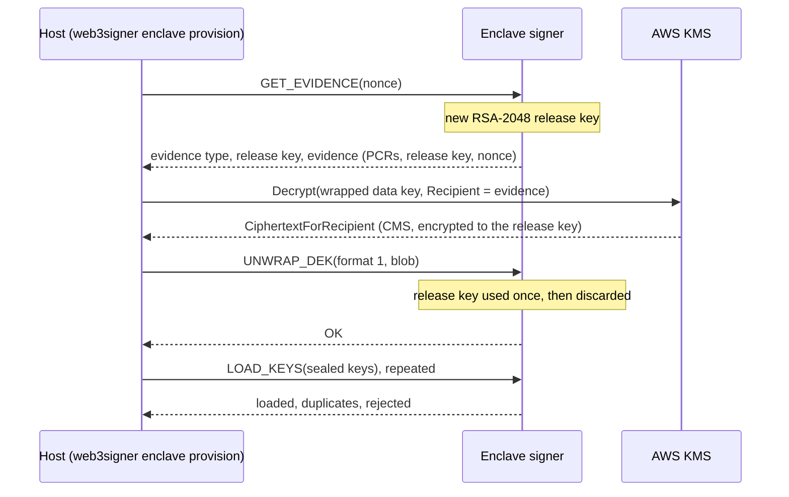

# Enclave signer protocol

`enclave-protocol` is the wire protocol between Web3Signer and the enclave signer, a small program
that holds BLS secret keys inside an enclave (AWS Nitro Enclaves today). Both sides use it: the
enclave signer (`enclave-signer`) and the host side (`enclave-host`, `signing`).

| Package | Contents |
|---|---|
| `enclave.protocol` | The codec: `Frames`, `Messages` (SSZ bodies and their records), `Ssz`, `Protocol` constants, `UnsupportedProtocolVersionException` |
| `enclave.transport` | `EnclaveAddress`, `Connection`, `Listener`; TCP and vsock behind them |
| `enclave.client` | `EnclaveClient`, `ProvisioningSession`, `EnclaveException`, `EnclaveUnavailableException`, `PartialLoadException` |

How to deploy it: [`deployments/aws-nitro/README.md`](../deployments/aws-nitro/README.md).

## Design

- **The enclave has no network.** Its only channel to the parent instance is a vsock stream socket.
  The protocol needs a byte stream and nothing else.
- **SSZ bodies.** Every message body is [SSZ](https://github.com/ethereum/ssz-specs), as in the
  consensus layer. The module carries its own codec for the small part of SSZ it needs (containers
  of `Uint8`, `Uint16`, `Uint32`, byte vectors and byte lists, with the byte lists last, and lists
  of fixed-size containers as a whole body). An encoder and its decoder list the fields in the same
  order as the SSZ type, and tests check every message against Teku's SSZ implementation.
- **The enclave image stays minimal.** The signer runs on a jlink `java.base` runtime. This module
  depends on the JDK only, and `enclave-signer` fails its build if anything else reaches its runtime
  classpath.
- **Signing is the hot path.** One signature costs about 450 µs of CPU in the enclave, and the
  signer signs the requests of one connection one after another. The client therefore sends one
  request at a time on each of a pool of connections, and the enclave's CPUs work through them in
  parallel ([Client behaviour](#client-behaviour)).
- **No secret travels in plaintext.** Requests carry signing roots and public keys. Provisioning
  carries public evidence, a blob that KMS encrypted to a key generated inside the enclave, and BLS
  keys sealed with AES-GCM. vsock does not leave the host, so the link has no TLS. A process on the
  parent that can reach the socket can ask for signatures: slashing protection stays in Web3Signer,
  as the deployment guide states.

## Transports and addresses

| Form | Use |
|---|---|
| `vsock:<cid>:<port>` | Connect to an enclave, for example `vsock:16:5000`. CIDs 0, 1, 2 and 4294967295 are refused |
| `vsock:<port>` | Listen inside the enclave, any CID |
| `tcp:<host>:<port>` | Connect or listen over TCP: the `dev` platform and tests |

vsock is used through the FFM API (`AF_VSOCK` on Linux), without native code of our own. `ECONNRESET`,
`ENOTCONN` and a read of 0 bytes all mean that the peer is gone.

TCP has no channel security. Platforms whose enclave is reached over a network (for example
confidential VMs) need an authenticated channel, such as attested TLS, before TCP can carry
production traffic.

## Constants

| Name | Value | Description |
|---|---|---|
| `MAX_BODY_SIZE` | `2**20` (= 1,048,576) | Bytes in a frame body |
| `MAX_ERROR_MESSAGE_SIZE` | `2**8` (= 256) | Bytes in an `ErrorMessage` |
| `MAX_NONCE_SIZE` | `2**6` (= 64) | Bytes in a `Nonce` |
| `MAX_PUBLIC_KEYS_PAGE` | `2**14` (= 16,384) | Public keys in one `GET_PUBLIC_KEYS` response |
| `MAX_LOAD_KEYS` | `2**12` (= 4,096) | Sealed keys in one `LOAD_KEYS` request |
| `MAX_VERSION_SIZE` | `2**8` (= 256) | Bytes in a `SignerVersion` |
| `MAX_RELEASE_KEY_SIZE` | `2**11` (= 2,048) | Bytes in a `ReleaseKey` |
| `MAX_EVIDENCE_SIZE` | `2**16` (= 65,536) | Bytes in a `PlatformEvidence` |
| `MAX_BLOB_SIZE` | `2**16` (= 65,536) | Bytes in a `ReleaseBlob` |

## Frames

Every request and every response is one frame: a fixed header, then a body of `length` bytes.

```
frame  = header ‖ body
header = SSZ(FrameHeader)                9 bytes
body   = SSZ(content)                    header.length bytes
```

```python
class FrameHeader(Container):
    length: Uint32       # bytes of the body, 0 to MAX_BODY_SIZE
    request_id: Uint32   # chosen by the client, echoed in the response
    kind: Uint8          # request: the opcode; response: the result code
```

- **Body:** a request's body is the request content of the message its `kind` names (see
  [Messages](#messages)). A response with `kind` `OK` carries that message's response content. Any
  other result code carries an [`ErrorMessage`](#errormessage), printable ASCII, as the consensus
  req/resp errors do. The enclave fills it with fixed text only, never with anything that depends on
  secret data.
- **Byte order:** every integer is little-endian, as in all SSZ.
- **Request ids:** the response to a request carries the same `request_id`. On one connection the
  server reads one request at a time and answers in request order. The client sends one request at
  a time per connection, checks the request id of every answer, and drops the connection on a
  mismatch.
- **Errors:** a `length` above `MAX_BODY_SIZE`, a malformed response body or an answer to another
  request closes the connection. A malformed request body is answered with `BAD_REQUEST`; the frame
  boundaries are intact, so the connection stays.

For example, a `STATUS` request with request id 7 has an empty body, and a `RESOURCE_UNAVAILABLE`
answer to request 7 carries the error message `no key`:

```
00000000 07000000 01                      length 0, request id 7, STATUS
06000000 07000000 03 6e6f206b6579         length 6, request id 7, RESOURCE_UNAVAILABLE, "no key"
```

## Messages

Protocol version 1. A request is a frame whose `kind` is the opcode, and its body is the request
content below. The response is a frame whose `kind` is the result code. With `OK` its body is the
response content below; with any other result it is an `ErrorMessage`.

A body that is a single list or value is that type on its own, not a container around it, as in the
consensus req/resp protocol (`BeaconBlocksByRoot`, `Ping`). A message with no content has an empty
body, since SSZ has no empty container.

### Types

#### `ErrorMessage`

```python
class ErrorMessage(List[Byte]):
    """
    The error message of a response whose result is not ``OK``.
    """

    LIMIT = MAX_ERROR_MESSAGE_SIZE
```

#### `Nonce`

```python
class Nonce(List[Byte]):
    """
    The caller's nonce in a ``GET_EVIDENCE`` request, bound into the evidence.
    """

    LIMIT = MAX_NONCE_SIZE
```

#### `PlatformEvidence`

```python
class PlatformEvidence(List[Byte]):
    """
    The platform's evidence for a release key, in a ``GET_EVIDENCE`` response.
    """

    LIMIT = MAX_EVIDENCE_SIZE
```

#### `PublicKeys`

```python
class PublicKeys(List[Bytes48]):
    """
    Compressed BLS public keys returned in a ``GET_PUBLIC_KEYS`` response.
    """

    LIMIT = MAX_PUBLIC_KEYS_PAGE
```

#### `ReleaseBlob`

```python
class ReleaseBlob(List[Byte]):
    """
    The data key encrypted to a release key, sent in an ``UNWRAP_DEK`` request.
    """

    LIMIT = MAX_BLOB_SIZE
```

#### `ReleaseKey`

```python
class ReleaseKey(List[Byte]):
    """
    The DER SubjectPublicKeyInfo of an RSA release key, in a ``GET_EVIDENCE``
    response.
    """

    LIMIT = MAX_RELEASE_KEY_SIZE
```

#### `SealedKeys`

```python
class SealedKeys(List[SealedKey]):
    """
    BLS secret keys sealed under the data key, sent in a ``LOAD_KEYS`` request.
    """

    LIMIT = MAX_LOAD_KEYS
```

#### `SignerVersion`

```python
class SignerVersion(List[Byte]):
    """
    The signer's implementation version, printable ASCII, in a ``STATUS`` response.
    """

    LIMIT = MAX_VERSION_SIZE
```

### Containers

#### `SealedKey`

```python
class SealedKey(Container):
    pubkey: Bytes48
    nonce: Bytes12
    ciphertext: Bytes48
```

### STATUS

**Opcode:** `0x01`

No Request Content.

Response Content:

```
(
  protocol_version: Uint8
  platform: Uint8
  cpus: Uint16
  key_count: Uint32
  boot_id: Bytes16
  version: SignerVersion
)
```

Reports what the signer is and what it holds. `protocol_version` comes first, so that a client can
refuse a signer of another version even when the rest of its answer has another layout (see
[Versioning](#versioning)). `platform` is `0` dev or `1` AWS Nitro. `cpus` is the processors
available to the signer, capped at 65,535. `key_count` is the number of loaded keys. `boot_id` is 16
random bytes chosen when the signer starts: a new boot id means that the enclave restarted and lost
its keys. `version` is the signer's implementation version, printable ASCII because it ends up in
logs.

### GET_PUBLIC_KEYS

**Opcode:** `0x02`

Request Content:

```
(
  offset: Uint32
  limit: Uint32
)
```

Response Content:

```
(
  PublicKeys
)
```

Returns up to `limit` public keys from position `offset`, in load order. `limit` is 1 to
`MAX_PUBLIC_KEYS_PAGE`; anything else is a `BAD_REQUEST`. The signer fills every page up to `limit`,
so a page shorter than `limit` is the last one.

### SIGN

**Opcode:** `0x03`

Request Content:

```
(
  pubkey: Bytes48
  signing_root: Bytes32
)
```

Response Content:

```
(
  Bytes96
)
```

Signs the 32-byte signing root with the key whose compressed public key is `pubkey`, and returns the
compressed signature. A key the signer does not hold is answered with `RESOURCE_UNAVAILABLE`.
Web3Signer's signing extension endpoint, which signs other payloads, is not available for enclave
keys.

### GET_EVIDENCE

**Opcode:** `0x10`

Request Content:

```
(
  Nonce
)
```

Response Content:

```
(
  evidence_type: Uint8
  release_key: ReleaseKey
  evidence: PlatformEvidence
)
```

Starts [provisioning](#provisioning). The signer generates a fresh RSA release key and returns its
DER SubjectPublicKeyInfo as `release_key`, with the platform's evidence that binds it and the nonce,
which is the whole request. Evidence is the platform's proof of what runs in the enclave (the IETF
RATS term). Evidence types: `0` dev, `1` an AWS Nitro attestation document whose public key is the
release key. A platform that produces no evidence answers `EVIDENCE_FAILED`.

The release key travels beside the evidence because some platforms only have room for a hash of it
inside: SEV-SNP and TDX reports carry 64 bytes of our data. The key release service must encrypt to
a release key the evidence binds. For AWS Nitro it does by construction: KMS verifies the document
and encrypts to the public key inside it, so the separate field is informational. A platform that
only binds a hash needs that hash checked against the release key.

### UNWRAP_DEK

**Opcode:** `0x11`

Request Content:

```
(
  format: Uint8
  blob: ReleaseBlob
)
```

No Response Content.

Hands the signer the release blob that a key release service encrypted to the release key of the
last `GET_EVIDENCE`. The signer opens it and keeps the data key inside for `LOAD_KEYS`. Format `1`
is the CMS EnvelopedData that AWS KMS returns for a recipient; another format is `UNSUPPORTED`. The
release key serves this one attempt whatever its outcome, and every blob that does not open is
answered with the same `UNWRAP_FAILED`. Without a release key the answer is `INVALID_STATE`.

### LOAD_KEYS

**Opcode:** `0x12`

Request Content:

```
(
  SealedKeys
)
```

Response Content:

```
(
  loaded: Uint32
  duplicates: Uint32
  rejected: Uint32
)
```

Adds sealed BLS keys to the signer, 1 to `MAX_LOAD_KEYS` per request. The data key from `UNWRAP_DEK`
encrypts each 32-byte secret with AES-256-GCM, with the public key as additional data; `ciphertext`
is the encrypted secret followed by the tag. `loaded` counts the keys added, `duplicates` the
entries whose public key was already loaded, by an earlier request or an earlier entry of this one,
and `rejected` the entries that did not open or whose secret does not match its public key. Without
a data key the answer is `INVALID_STATE`.

### Result codes

Result codes 0 to 3 mean what they mean in the consensus req/resp protocol; the protocol's own codes
start at 128.

| Code | Name | Meaning |
|---|---|---|
| 0 | `OK` | Success |
| 1 | `BAD_REQUEST` | Malformed body (req/resp `InvalidRequest`) |
| 2 | `INTERNAL_ERROR` | The signer failed (req/resp `ServerError`) |
| 3 | `RESOURCE_UNAVAILABLE` | The signer does not hold the key a `SIGN` asks for (req/resp `ResourceUnavailable`) |
| 128 | `UNSUPPORTED` | Unknown opcode or blob format |
| 130 | `INVALID_STATE` | Provisioning step out of order |
| 131 | `UNWRAP_FAILED` | The release blob did not open |
| 132 | `EVIDENCE_FAILED` | The platform produced no evidence |

## Provisioning

Provisioning moves the data key into the enclave and loads the sealed keys with it. Its state
belongs to one connection, and closing the connection discards it. `ProvisioningSession` pins that
connection, never retries, and waits for each response as long as its caller allows (a key release
may wait for a person to approve it).



| State | `GET_EVIDENCE` | `UNWRAP_DEK` | `LOAD_KEYS` |
|---|---|---|---|
| Idle | → KeyPending | `INVALID_STATE` | `INVALID_STATE` |
| KeyPending: a release key waits for its unwrap | → KeyPending, with a new key | → DekHeld | `INVALID_STATE` |
| DekHeld: the data key opens sealed keys | → KeyPending; the data key is zeroed | `INVALID_STATE` | → DekHeld |

Failures:

- **`GET_EVIDENCE` refused** (`EVIDENCE_FAILED`, `INTERNAL_ERROR`): → Idle from any state. The old
  release key and data key are discarded before the new key is made, so nothing is left behind. A
  malformed request (`BAD_REQUEST`) changes nothing.
- **`UNWRAP_DEK` refused** (`UNWRAP_FAILED`, `UNSUPPORTED`, `BAD_REQUEST`) in KeyPending: → Idle. The
  release key is used up whatever the outcome.
- **`LOAD_KEYS` refused** (`BAD_REQUEST`) in DekHeld: stays DekHeld.

Invariants:

- **No operation returns secret material.** `SIGN` returns signatures, `GET_PUBLIC_KEYS` public keys.
- **Each release key serves one unwrap**, whatever its outcome. A failed unwrap needs a new
  `GET_EVIDENCE`.
- **Every unwrap failure looks the same** (`UNWRAP_FAILED`, the same error message, no padding
  check), so the parent cannot use the enclave as a decryption oracle.
- **`LOAD_KEYS` only adds keys.** An entry is accepted only if GCM authenticates it, the secret is a
  valid BLS scalar, and its public key equals the entry's. Already loaded keys count as duplicates.
  Removing keys means restarting the enclave.

## Client behaviour

`EnclaveClient` is shared by everything that signs through the enclave.

- **Connection pool:** `SIGN`, `STATUS` and `GET_PUBLIC_KEYS` borrow a connection from a pool of at
  most `connections` (default 32), send one request on the caller's thread, read the answer and give
  the connection back. Connections are opened on demand and kept while they work. The signer accepts
  64 connections, so the default leaves room for provisioning and for other clients.
- **Retries:** a request that fails on a pooled connection is sent once more on a new connection,
  because after an enclave restart every pooled connection is stale. A failure on a new connection,
  a timeout and a refusal are not retried. A failed connection is closed and leaves the pool.
  Provisioning is never retried.
- **Listing keys:** `publicKeys` reads the boot id from `STATUS` before and after paging. If it
  changed, the enclave restarted in between and the pages come from two key sets, so the call fails
  with `EnclaveUnavailableException` and the caller can list again.
- **Timeouts:** `requestTimeoutMillis` (default 2000 ms) bounds the wait for a free connection, the
  connect, and each read and write call; a vsock connect is bounded by the kernel instead (about 2
  s), and provisioning responses take the session's timeout. A frame takes at least two reads, the
  header and the body, so a signer that answers slowly but steadily can take longer than one
  timeout. A request to a signer that stops answering fails after about one timeout (the read on its
  pooled connection). The worst case is a full wait for a free connection, then a stale pooled
  connection, then a new one whose connect, write and read each run up to the timeout: 5 times the
  timeout, 10 s with the defaults.
- **Closing:** `close` closes every connection, provisioning sessions included, which fails the
  requests in flight, and fails the callers that wait for a connection. A connection can be closed
  while another thread is inside a call on it: the socket is shut down at once, which wakes that
  thread, and the descriptor and the native buffers are freed when the call returns, so a descriptor
  number is never reused under a running call.
- **Failures:** `EnclaveUnavailableException` when the enclave cannot answer (timeout, no free
  connection, connection failure, closed client); `EnclaveException` with the result code and the
  enclave's message when it refuses; `UnsupportedProtocolVersionException` from `STATUS` when the
  signer speaks another protocol version, which no retry can fix. `ProvisioningSession.loadKeys`
  throws `PartialLoadException`, with the counts of the requests that succeeded, when a later
  request fails: those keys stay loaded.

## Versioning

`STATUS` reports the protocol version as its first field. The client reads it before the rest of
the body and refuses a signer that speaks another version without retrying, so a later `STATUS`
layout is reported as a version mismatch rather than as a malformed answer. A signer answers an
opcode it does not know with `UNSUPPORTED`.
