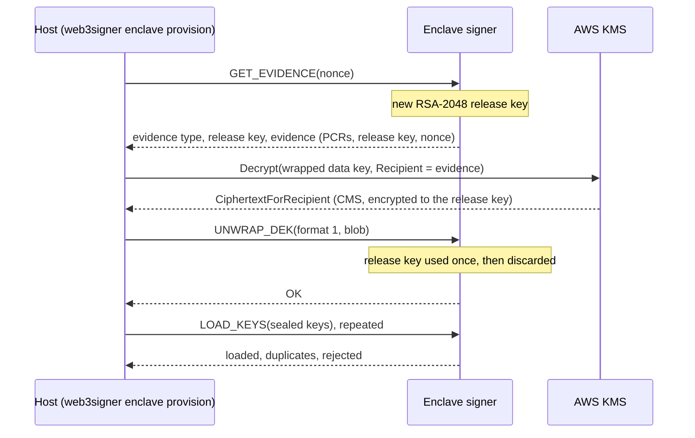

# Enclave signer protocol

`enclave-protocol` is the wire protocol between Web3Signer and the enclave signer, a small program
that holds BLS secret keys inside an enclave (AWS Nitro Enclaves today). Both sides use it: the
enclave signer (`enclave-signer`) and the host side (`enclave-host`, `signing`).

| Package | Contents |
|---|---|
| `enclave.protocol` | The codec: `Frames`, `Messages` (SSZ bodies and their records), `Ssz`, `Protocol` constants |
| `enclave.transport` | `EnclaveAddress`, `Connection`, `Listener`; TCP and vsock behind them |
| `enclave.client` | `EnclaveClient`, `ProvisioningSession`, `EnclaveException`, `EnclaveUnavailableException` |

How to deploy it: [`deployments/aws-nitro/README.md`](../deployments/aws-nitro/README.md).

## Design

- **The enclave has no network.** Its only channel to the parent instance is a vsock stream socket.
  The protocol needs a byte stream and nothing else.
- **SSZ bodies.** Every message body is [SSZ](https://github.com/ethereum/ssz-specs), as in the
  consensus layer. The module carries its own codec for the small part of SSZ it needs (containers
  of `uint8`, `uint16`, `uint32`, byte vectors and byte lists, with the byte lists last, and lists
  of fixed-size containers as a whole body). An encoder and its decoder list the fields in the same
  order as the SSZ type, and tests check every message against Teku's SSZ implementation.
- **The enclave image stays minimal.** The signer runs on a jlink `java.base` runtime. This module
  depends on the JDK only, and `enclave-signer` fails its build if anything else reaches its runtime
  classpath.
- **Signing is the hot path.** One signature costs about 450 µs of CPU in the enclave, and the
  signer signs the requests of one connection one after another. The client therefore sends one
  request at a time on each of a pool of connections, and the enclave's CPUs work through them in
  parallel ([Client behaviour](#client-behaviour)).
- **No secret travels in plaintext.** Requests carry signing roots and public keys. Provisioning
  carries public evidence, a blob that KMS encrypted to a key generated inside the enclave, and BLS
  keys sealed with AES-GCM. vsock does not leave the host, so the link has no TLS. A process on the
  parent that can reach the socket can ask for signatures: slashing protection stays in Web3Signer,
  as the deployment guide states.

## Transports and addresses

| Form | Use |
|---|---|
| `vsock:<cid>:<port>` | Connect to an enclave, for example `vsock:16:5000`. CIDs 0, 1, 2 and 4294967295 are refused |
| `vsock:<port>` | Listen inside the enclave, any CID |
| `tcp:<host>:<port>` | Connect or listen over TCP: the `dev` platform and tests |

vsock is used through the FFM API (`AF_VSOCK` on Linux), without native code of our own. `ECONNRESET`,
`ENOTCONN` and a read of 0 bytes all mean that the peer is gone.

TCP has no channel security. Platforms whose enclave is reached over a network (for example
confidential VMs) need an authenticated channel, such as attested TLS, before TCP can carry
production traffic.

## Frames

A frame is a fixed SSZ container followed by an SSZ body:

```python
class FrameHeader(Container):
    length: uint32      # bytes of the body, at most 1,048,576
    request_id: uint32  # chosen by the client, echoed in the response
    kind: uint8         # request: the opcode; response: the result code
```

- On one connection the server reads one request at a time and answers in request order. The client
  sends one request at a time per connection, checks the request id of every answer, and drops the
  connection on a mismatch.
- A response with the result `OK` carries the operation's response body. Any other result carries
  `ErrorMessage = List[byte, 256]`, printable ASCII, as the consensus req/resp errors do. The
  enclave fills it with fixed text only, never with anything that depends on secret data.
- A body announced above 1 MiB, a malformed response body or an answer to another request closes
  the connection. A malformed request body is answered with `BAD_REQUEST`; the frame boundaries are
  intact, so the connection stays.

## Operations

Protocol version 1.

```python
# Requests (the body follows a FrameHeader whose kind is the opcode)

# 0x01 STATUS: empty body (SSZ has no empty containers)

class GetPublicKeysRequest(Container):      # 0x02 GET_PUBLIC_KEYS
    offset: uint32
    limit: uint32                           # 1 to 16,384

class SignRequest(Container):               # 0x03 SIGN
    pubkey: Bytes48
    signing_root: Bytes32

GetEvidenceRequest = List[byte, 64]         # 0x10 GET_EVIDENCE: the nonce

class UnwrapDekRequest(Container):          # 0x11 UNWRAP_DEK
    format: uint8                           # 1 = CMS
    blob: List[byte, 65536]

class SealedKey(Container):
    pubkey: Bytes48
    nonce: Bytes12
    ciphertext: Bytes48                     # AES-256-GCM ciphertext and tag

LoadKeysRequest = List[SealedKey, 4096]     # 0x12 LOAD_KEYS: at least 1

# Responses with the result OK

class StatusResponse(Container):
    protocol_version: uint8
    platform: uint8
    cpus: uint16                            # capped at 65,535
    key_count: uint32
    boot_id: Bytes16
    version: List[byte, 256]

GetPublicKeysResponse = List[Bytes48, 16384]

SignResponse = Bytes96                      # compressed

class GetEvidenceResponse(Container):
    evidence_type: uint8
    release_key: List[byte, 2048]           # DER SubjectPublicKeyInfo, RSA
    evidence: List[byte, 65536]

# UNWRAP_DEK: empty body

class LoadKeysResponse(Container):
    loaded: uint32
    duplicates: uint32
    rejected: uint32
```

- **Bare bodies:** a body that is one list or one value is that type on its own, not a container
  around it, as in the consensus req/resp protocol (`BeaconBlocksByRoot`, `Ping`).
- **Platform:** `0` dev, `1` AWS Nitro.
- **Boot id:** 16 random bytes chosen when the signer starts. A new boot id means that the enclave
  restarted and lost its keys.
- **Version:** the signer's implementation version, printable ASCII, because it ends up in logs.
- **`SIGN`** signs a 32-byte signing root. Web3Signer's signing extension endpoint, which signs
  other payloads, is not available for enclave keys.
- **`GET_PUBLIC_KEYS`** pages through the keys in load order. The signer fills every page up to
  `limit`, so a page shorter than `limit` is the last one.
- **Evidence** is the platform's proof of what runs in the enclave (the IETF RATS term). The
  release key travels beside the evidence, because some platforms only have room for a hash of it
  inside: SEV-SNP and TDX reports carry 64 bytes of our data. Evidence types: `0` dev, `1` an AWS
  Nitro attestation document whose public key is the release key. The key release service must
  encrypt to a release key the evidence binds. For AWS Nitro it does by construction: KMS verifies
  the document and encrypts to the public key inside it, so the separate field is informational.
  A platform that only binds a hash needs that hash checked against the release key.
- **Sealed key:** the data key encrypts the 32-byte secret, with the public key as additional data.

Result codes 0 to 3 mean what they mean in the consensus req/resp protocol; the protocol's own codes
start at 128.

| Code | Name | Meaning |
|---|---|---|
| 0 | `OK` | Success |
| 1 | `BAD_REQUEST` | Malformed body (req/resp `InvalidRequest`) |
| 2 | `INTERNAL_ERROR` | The signer failed (req/resp `ServerError`) |
| 3 | `RESOURCE_UNAVAILABLE` | The signer does not hold the key a `SIGN` asks for (req/resp `ResourceUnavailable`) |
| 128 | `UNSUPPORTED` | Unknown opcode or blob format |
| 130 | `INVALID_STATE` | Provisioning step out of order |
| 131 | `UNWRAP_FAILED` | The release blob did not open |
| 132 | `EVIDENCE_FAILED` | The platform produced no evidence |

## Provisioning

Provisioning moves the data key into the enclave and loads the sealed keys with it. Its state
belongs to one connection, and closing the connection discards it. `ProvisioningSession` pins that
connection, never retries, and waits for each response as long as its caller allows (a key release
may wait for a person to approve it).



| State | `GET_EVIDENCE` | `UNWRAP_DEK` | `LOAD_KEYS` |
|---|---|---|---|
| Idle | → KeyPending | `INVALID_STATE` | `INVALID_STATE` |
| KeyPending: a release key waits for its unwrap | → KeyPending, with a new key | → DekHeld | `INVALID_STATE` |
| DekHeld: the data key opens sealed keys | → KeyPending; the data key is zeroed | `INVALID_STATE` | → DekHeld |

Failures:

- **`GET_EVIDENCE` refused** (`EVIDENCE_FAILED`, `INTERNAL_ERROR`): → Idle from any state. The old
  release key and data key are discarded before the new key is made, so nothing is left behind. A
  malformed request (`BAD_REQUEST`) changes nothing.
- **`UNWRAP_DEK` refused** (`UNWRAP_FAILED`, `UNSUPPORTED`, `BAD_REQUEST`) in KeyPending: → Idle. The
  release key is used up whatever the outcome.
- **`LOAD_KEYS` refused** (`BAD_REQUEST`) in DekHeld: stays DekHeld.

Invariants:

- **No operation returns secret material.** `SIGN` returns signatures, `GET_PUBLIC_KEYS` public keys.
- **Each release key serves one unwrap**, whatever its outcome. A failed unwrap needs a new
  `GET_EVIDENCE`.
- **Every unwrap failure looks the same** (`UNWRAP_FAILED`, the same error message, no padding
  check), so the parent cannot use the enclave as a decryption oracle.
- **`LOAD_KEYS` only adds keys.** An entry is accepted only if GCM authenticates it, the secret is a
  valid BLS scalar, and its public key equals the entry's. Already loaded keys count as duplicates.
  Removing keys means restarting the enclave.

## Client behaviour

`EnclaveClient` is shared by everything that signs through the enclave.

- **Connection pool:** `SIGN`, `STATUS` and `GET_PUBLIC_KEYS` borrow a connection from a pool of at
  most `connections` (default 32), send one request on the caller's thread, read the answer and give
  the connection back. Connections are opened on demand and kept while they work. The signer accepts
  64 connections, so the default leaves room for provisioning and for other clients.
- **Retries:** a request that fails on a pooled connection is sent once more on a new connection,
  because after an enclave restart every pooled connection is stale. A failure on a new connection,
  a timeout and a refusal are not retried. A failed connection is closed and leaves the pool.
  Provisioning is never retried.
- **Timeouts:** `requestTimeoutMillis` (default 2000 ms) bounds the wait for a free connection, and
  connect, read and write each; a vsock connect is bounded by the kernel instead (about 2 s), and
  provisioning responses take the session's timeout. A request to a signer that stops answering
  fails after about one timeout (the read on its pooled connection). The worst case is a stale
  pooled connection followed by a new one whose connect, write and read each run up to the timeout:
  4 times the timeout, 8 s with the defaults.
- **Closing:** `close` closes every connection, provisioning sessions included, which fails the
  requests in flight, and fails the callers that wait for a connection. A connection can be closed
  while another thread is inside a call on it: the socket is shut down at once, which wakes that
  thread, and the descriptor and the native buffers are freed when the call returns, so a descriptor
  number is never reused under a running call.
- **Failures:** `EnclaveUnavailableException` when the enclave cannot answer (timeout, no free
  connection, connection failure, closed client, another protocol version); `EnclaveException` with
  the result code and the enclave's message when it refuses. `ProvisioningSession.loadKeys` throws
  `PartialLoadException`, with the counts of the requests that succeeded, when a later request
  fails: those keys stay loaded.

## Versioning

`STATUS` reports the protocol version as its first field. The client reads it before the rest of
the body and refuses a signer that speaks another version without retrying, so a later `STATUS`
layout is reported as a version mismatch rather than as a malformed answer. A signer answers an
opcode it does not know with `UNSUPPORTED`.
