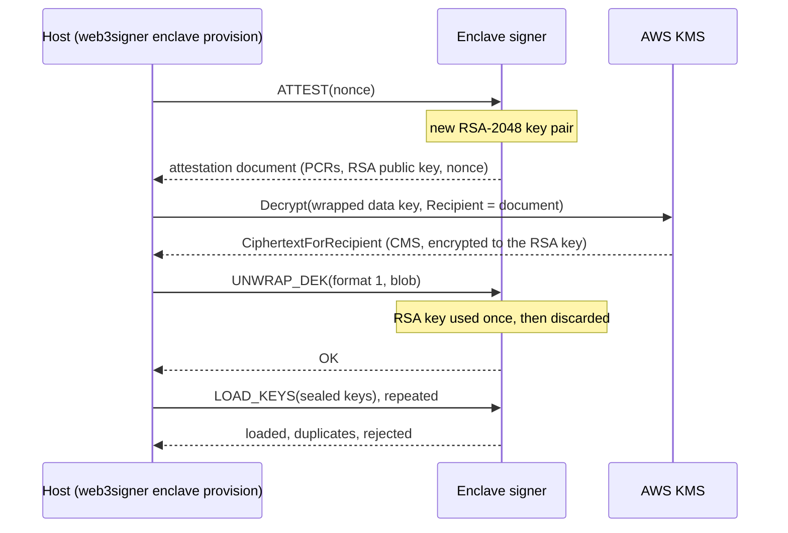

# Enclave signer protocol

`enclave-protocol` is the wire protocol between Web3Signer and the enclave signer, a small program
that holds BLS secret keys inside an enclave (AWS Nitro Enclaves today). The module contains the
frame and payload codecs, the TCP and vsock transports, and `EnclaveClient`. Both sides use it: the
enclave signer (`enclave-signer`) and the host side (`enclave-host`, `signing`).

How to deploy it: [`deployments/aws-nitro/README.md`](../deployments/aws-nitro/README.md).

## Why a custom protocol

- **The enclave has no network.** Its only channel to the parent instance is a vsock stream socket.
  The protocol needs a byte stream and nothing else.
- **The enclave image stays minimal.** The signer runs on a jlink `java.base` runtime. This module
  depends on the JDK only, and `enclave-signer` fails its build if anything else reaches its runtime
  classpath. An HTTP or gRPC stack would add code to the measured image and to what has to be
  reviewed there.
- **Signing is the hot path.** One signature costs about 450 µs of CPU in the enclave. Framing a
  request costs a few bytes and no parsing, and several requests travel in one write
  ([Batching](#client-behaviour)).
- **No secret travels in plaintext, so the link has no TLS.** vsock does not leave the host. Requests
  carry signing roots and public keys. Provisioning carries a public attestation document, a blob
  that KMS encrypted to a key generated inside the enclave, and BLS keys sealed with AES-GCM. A
  process on the parent that can reach the socket can ask for signatures: slashing protection stays
  in Web3Signer, as the deployment guide states.

## Transports and addresses

| Form | Use |
|---|---|
| `vsock:<cid>:<port>` | Connect to an enclave, for example `vsock:16:5000` |
| `vsock:<port>` | Listen inside the enclave, any CID |
| `tcp:<host>:<port>` | Connect or listen over TCP: the `dev` platform and tests |

vsock is used through the FFM API (`AF_VSOCK` on Linux), without native code of our own. `ECONNRESET`,
`ENOTCONN` and a read of 0 bytes all mean that the peer is gone.

## Frames

All integers are big-endian.

| Field | Size | Content |
|---|---|---|
| length | u32 | Bytes that follow: 5 + payload. From 5 to 1,048,576 |
| type | u8 | Opcode; a response sets bit `0x80` (`RESPONSE_FLAG`) |
| request id | u32 | Chosen by the client, echoed in the response |
| payload | length − 5 | Operation specific |

Every response payload starts with a status byte. A response with a status other than `OK` has no
other bytes. A length outside the range closes the connection.

On one connection the server answers in request order. The client checks the request id and type of
every answer and drops the connection on a mismatch. The server handles every complete request in
its input buffer and writes the responses together.

## Operations

Protocol version 1.

| Opcode | Name | Request payload | Response payload after the status byte |
|---|---|---|---|
| `0x01` | `STATUS` | empty | protocol version u16 · platform u8 · cpus u16 · key count u32 · boot id 16 bytes · version length u8 · version |
| `0x02` | `GET_PUBLIC_KEYS` | offset u32 · limit u32 (1 to 16,384) | total u32 · count u32 · count × 48-byte public key |
| `0x03` | `SIGN` | public key 48 bytes · message length u16 · message (up to 65,535 bytes) | signature, 96 bytes compressed |
| `0x10` | `ATTEST` | nonce length u8 · nonce (up to 64 bytes) | document length u32 · attestation document |
| `0x11` | `UNWRAP_DEK` | format u8 (`1` = CMS) · blob length u32 · blob | empty |
| `0x12` | `LOAD_KEYS` | count u32 (1 to 4,096) · count × sealed key | loaded u32 · duplicates u32 · rejected u32 |

- **Platform:** `0` dev, `1` AWS Nitro.
- **Boot id:** 16 random bytes chosen when the signer starts. A new boot id means that the enclave
  restarted and lost its keys.
- **Version:** the signer's implementation version. The client keeps printable ASCII only, because
  the value ends up in logs.
- **`GET_PUBLIC_KEYS`** pages through the keys in load order.
- **Sealed key**, 108 bytes: public key (48) · nonce (12) · AES-256-GCM ciphertext and tag (48). The
  data key encrypts the 32-byte secret, with the public key as additional data.

Status codes:

| Code | Name | Meaning |
|---|---|---|
| 0 | `OK` | |
| 1 | `BAD_REQUEST` | Malformed payload |
| 2 | `UNSUPPORTED` | Unknown opcode or blob format |
| 3 | `UNKNOWN_KEY` | `SIGN` for a key the enclave does not hold |
| 4 | `INVALID_STATE` | Provisioning step out of order |
| 5 | `UNWRAP_FAILED` | The release blob did not open |
| 6 | `ATTESTATION_FAILED` | The platform gave no attestation document |
| 7 | `INTERNAL_ERROR` | |

## Provisioning

Provisioning moves the data key into the enclave and loads the sealed keys with it. Its state
belongs to one connection, and closing the connection discards it. `ProvisioningSession` pins that
connection and never retries.

| State | `ATTEST` | `UNWRAP_DEK` | `LOAD_KEYS` |
|---|---|---|---|
| Idle | → KeyPending | `INVALID_STATE` | `INVALID_STATE` |
| KeyPending: an RSA key waits for its unwrap | → KeyPending, with a new key | → DekHeld, or Idle on failure | `INVALID_STATE` |
| DekHeld: the data key opens sealed keys | → KeyPending; the data key is zeroed | `INVALID_STATE` | → DekHeld |

Invariants:

- **No operation returns secret material.** `SIGN` returns signatures, `GET_PUBLIC_KEYS` public keys.
- **Each RSA key serves one unwrap**, whatever its outcome. A failed unwrap needs a new `ATTEST`.
- **Every unwrap failure looks the same** (`UNWRAP_FAILED`, no padding check), so the parent cannot
  use the enclave as a decryption oracle.
- **`LOAD_KEYS` only adds keys.** An entry is accepted only if GCM authenticates it, the secret is a
  valid BLS scalar, and its public key equals the entry's. Already loaded keys count as duplicates.
  Removing keys means restarting the enclave.

## Client behaviour

`EnclaveClient` is shared by everything that signs through the enclave.

- **`SIGN`** goes through dispatcher threads, each with its own connection. A dispatcher takes the
  calls already queued, up to `maxBatch` (default 8), sends them in one write and reads the answers
  in order. With `connections = 0` (the default) the client starts one dispatcher per CPU that
  `STATUS` reports, at most 32 (the signer accepts 64 connections; the rest stay free for `STATUS`,
  `GET_PUBLIC_KEYS` and provisioning).
- **Retries:** after an I/O error or a mismatched answer, a dispatcher reconnects once and resends
  the unanswered calls. `STATUS` and `GET_PUBLIC_KEYS` use a short-lived connection and retry once.
  Provisioning is never retried.
- **Timeouts:** each call waits at most `requestTimeoutMillis` (default 2000 ms); connect, read and
  write use the same limit, except a vsock connect, which the kernel bounds at about 2 s. The queue
  holds 4,096 calls; a full queue fails a call at once.
- **Closing:** a connection can be closed while another thread is inside a call on it. The socket is
  shut down at once, which wakes that thread; the descriptor and the native buffers are freed when
  the call returns, so a descriptor number is never reused under a running call.
- **Failures:** `EnclaveUnavailableException` when the enclave cannot answer (timeout, full queue,
  connection failure, closed client); `EnclaveException` with the status when it refuses.

## Versioning

`STATUS` reports the protocol version. The host refuses to provision or load keys from a signer that
speaks another version. A signer answers an opcode it does not know with `UNSUPPORTED`.
